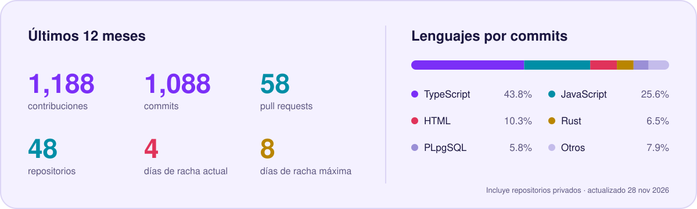
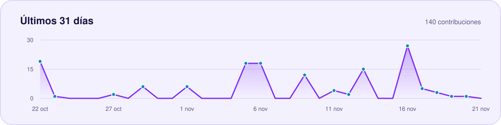

<div align="center">

<picture>
  <source media="(prefers-color-scheme: dark)" srcset="https://raw.githubusercontent.com/nelson-cz/nelson-cz/main/assets/header-dark.svg" />
  
</picture>

<a href="https://github.com/nelson-cz">
  
</a>

<br/>

<a href="https://TU_PORTFOLIO"></a>
<a href="mailto:nelson@czlabs.io"></a>
<a href="https://czlabs.io"></a>


</div>

<br/>

```console
nelson@parrot:~$ whoami
infra + backend @ czlabs

nelson@parrot:~$ cat ahora.txt
construyendo un sistema de heatmaps y analítica de producto

nelson@parrot:~$ cat aprendiendo.txt
rust, ciberseguridad, seo técnico

nelson@parrot:~$ date +%Z
CST (UTC-6), Guatemala
```

## CZLabs

Somos un laboratorio de desarrollo Web3 que diseña, construye y opera productos e infraestructura sobre **Solana**.

| | Especialidad | En la práctica |
|:-:|---|---|
| 🟣 | **DeFi** | Swaps, ruteo de liquidez, cotizaciones y staking |
| 🔵 | **Infraestructura de nodos** | RPC, WebSocket y streams gRPC de baja latencia para traders, bots y dApps |
| 🟡 | **Backends y datos en tiempo real** | Servicios de alto rendimiento, indexación on-chain y analítica de producto |
| 🔴 | **Operación segura** | Hardening de servidores, gestión de secretos, CI/CD y observabilidad |

### Mi parte

| Área | Qué hago |
|---|---|
| 🔵 Gateways de nodos | Balanceo y terminación TLS para RPC, WebSocket y gRPC; failover automático a nodos de respaldo; rate-limiting y blocklists |
| 🟡 Observabilidad | Métricas y logs centralizados de varios servidores con Prometheus, Loki y Grafana |
| 🟡 Bases de datos | Replica sets de MongoDB con alta disponibilidad; migraciones de datos sin downtime |
| 🔴 Seguridad | Hardening de hosts con nftables, acceso por VPN y jump host, rotación de credenciales, secretos servidos desde Cloudflare Workers |
| 🔵 CI/CD | Pipelines declarativos en Jenkins con builds por commit y despliegue con Docker Compose |
| 🟣 Producto | Tracking de usuarios y heatmaps para los frontends de la empresa |

## Stack

| | |
|---|---|
| 🟣 **Lenguajes y Web3** |       |
| 🔵 **Infra y DevOps** |         |
| 🟡 **Datos y observabilidad** |       |
| 🔴 **Seguridad** |     |

## Actividad

<div align="center">

<picture>
  <source media="(prefers-color-scheme: dark)" srcset="https://raw.githubusercontent.com/nelson-cz/nelson-cz/output/stats-dark.svg" />
  
</picture>

<picture>
  <source media="(prefers-color-scheme: dark)" srcset="https://raw.githubusercontent.com/nelson-cz/nelson-cz/output/activity-dark.svg" />
  
</picture>

<picture>
  <source media="(prefers-color-scheme: dark)" srcset="https://raw.githubusercontent.com/nelson-cz/nelson-cz/output/github-snake-dark.svg" />
  
</picture>

</div>

<div align="center">

<picture>
  <source media="(prefers-color-scheme: dark)" srcset="https://capsule-render.vercel.app/api?type=waving&height=120&section=footer&color=0:3DE8EC,45:7B2FF7,100:15112E" />
  
</picture>

</div>
